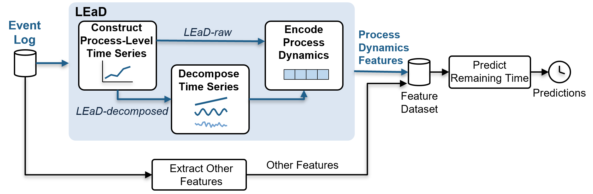

# LEaD: Lag Encoding of Process Dynamics for Remaining Time Prediction

This repository is the supplementary material of the paper *"LEaD: Lag Encoding of Process Dynamics for Remaining Time Prediction"*. It contains the code, the configurations, and the results needed to reproduce all experiments, tables, and figures of the paper.

**LEaD** encodes recent *process dynamics* as features for remaining time prediction. It tracks process-level characteristics (e.g., the number of active cases) at regular time intervals, **independently of when individual cases record events**. It then encodes the most recent values of these time series, either directly (**LEaD-raw**) or after decomposing them into a trend, a seasonal pattern, and irregular fluctuations (**LEaD-decomposed**). LEaD provides features, not a model, so it can be combined with any predictive model. The paper uses a random forest and XGBoost.

<p align="center">
  
</p>

## Contents

1. [Overview of the approach](#1-overview-of-the-approach)
2. [Repository structure](#2-repository-structure)
3. [Set up the Python environments](#3-set-up-the-python-environments)
4. [Download the event logs](#4-download-the-event-logs)
5. [Prepare the logs (prefixes, time series, decomposition)](#5-prepare-the-logs)
6. [Compute the baseline features](#6-compute-the-baseline-features)
7. [Train and test the tree-based models (random forest, XGBoost)](#7-train-and-test-the-tree-based-models)
8. [Train and test the LSTM reference](#8-train-and-test-the-lstm-reference)
9. [Reproduce the tables and figures of the paper](#9-reproduce-the-tables-and-figures-of-the-paper)
10. [Results](#10-results)
11. [Naming: paper vs. code](#11-naming-paper-vs-code)
12. [Hardware and runtime](#12-hardware-and-runtime)
13. [Acknowledgements](#13-acknowledgements)

---

## 1. Overview of the approach

For a prefix of a running case with prediction timepoint τ (the timestamp of its last event), LEaD works in three steps:

| Step | What it does | Configurations |
|---|---|---|
| **Construct process-level time series** | Divides the time span of the log into consecutive windows of one day (time-based tumbling windows) and measures three process-level characteristics per window: **new case count (NC)**, **active case count (AC)**, and **active resource count (AR)**. | both |
| **Decompose time series** | Decomposes each time series with STL into trend (T), seasonal (S), and residual (R) components. For each window *t*, STL is fitted on the series **from the first window of the log up to *t*** (expanding window), so no information after the prediction timepoint is used. Requires at least two seasonal periods (2*p* windows). | LEaD-decomposed only |
| **Encode process dynamics** | Encodes the last *k* completed windows before τ (the *lags*): their raw values (LEaD-raw, *k* features per characteristic) or their T, S, and R components (LEaD-decomposed, 3*k* features per characteristic). | both |

The process dynamics features are combined with the other features of each prefix (case attributes, aggregated event attributes, and calendar features) and passed to the predictive model. All prefixes whose prediction timepoint falls into the same day receive the same process dynamics features. The history LEaD encodes therefore does not depend on how long a case has been running: a prefix of a single event also receives *k* days of history.

**Hyperparameters of LEaD:** the number of lags *k* ∈ {2, 7, 14} and, for LEaD-decomposed, the seasonal period *p* ∈ {7, 30} days. Both are selected on the validation set, per log.


## 2. Set up the Python environments

We use two conda environments, with the exact package versions of our runs: one for data preparation, LEaD, the tree-based models, and the analysis, and one with TensorFlow for the LSTM of the benchmark. They are separate because they need different major versions of NumPy and pandas.

**Main environment** (preparation, random forest, XGBoost, statistical tests, tables, figures):

```bash
conda create -n lead python=3.10
conda activate lead
pip install -r requirements.txt
```

**LSTM environment** (only for `evaluation/run_lstm.py`):

```bash
conda create -n lead-lstm python=3.11
conda activate lead-lstm
pip install -r requirements_lstm.txt
```

| Package | Main (`requirements.txt`, Python 3.10) | LSTM (`requirements_lstm.txt`, Python 3.11) |
|---|---|---|
| numpy | 1.26.4 | 2.4.6 |
| pandas | 2.3.3 | 3.1.0 |
| scipy | 1.15.2 | |
| statsmodels | 0.15.0 | |
| scikit-learn | 1.7.2 | 1.9.1 |
| xgboost | 3.2.0 | |
| PyYAML | 6.0.3 | 6.0.3 |
| matplotlib | 3.10.9 | |
| tensorflow | | 2.21.0 |

All commands below are run from the root of the repository.

## 3. Download the event logs

We use the preprocessed event logs of the benchmark of Verenich et al. ([time-prediction-benchmark](https://github.com/verenich/time-prediction-benchmark)), file `experiments/logdata/logs.zip`. Unzip the CSV files into `data/raw/`:

```bash
mkdir -p data/raw
# download logs.zip from https://github.com/verenich/time-prediction-benchmark/blob/master/experiments/logdata/logs.zip
unzip logs.zip -d data/raw/
```

Of the 17 logs of the benchmark, we exclude *credit* (no resource information) and *invoice* (its time span is too short for a reliable decomposition). The remaining 15 logs are:

| Log | Code name | Cases | Events | Time span (days) |
|---|---|---:|---:|---:|
| BPIC11 | `bpic2011` | 1,140 | 149,730 | 1,172 |
| BPIC12-A | `bpic2012a` | 12,007 | 53,952 | 152 |
| BPIC12-O | `bpic2012o` | 3,487 | 15,908 | 165 |
| BPIC12-W | `bpic2012w` | 9,650 | 72,380 | 165 |
| BPIC15-1 | `bpic20151` | 696 | 28,775 | 1,611 |
| BPIC15-2 | `bpic20152` | 753 | 41,202 | 1,704 |
| BPIC15-3 | `bpic20153` | 1,328 | 57,488 | 1,889 |
| BPIC15-4 | `bpic20154` | 577 | 24,234 | 1,930 |
| BPIC15-5 | `bpic20155` | 1,051 | 54,562 | 1,922 |
| BPIC17 | `bpic2017` | 31,509 | 561,671 | 397 |
| Helpdesk | `helpdesk` | 3,218 | 10,598 | 982 |
| Hospital Billing | `hospital` | 59,228 | 330,945 | 1,130 |
| Production | `production` | 225 | 4,543 | 89 |
| Sepsis | `sepsis` | 1,035 | 5,176 | 476 |
| RTFM (Road Traffic Fine Management) | `traffic_fines` | 150,370 | 561,470 | 4,917 |

## 4. Prepare the logs

```bash
python evaluation/experiment_lag.py --prepare-only --periods 7 30 --ks 14
```

For each log, this step writes the following to `data/prepared/`:

- `<log>_table.pkl`: one row per prefix, with its set (train, validation, test), its label (remaining time), the case-level features F1, the calendar features F2, and the Base-last features;
- `<log>_series.pkl`: the daily time series of AC, NC, and AR over the whole log, and their expanding-window STL components for *p* = 7;
- `<log>_components_p30.pkl`: the STL components for *p* = 30 (only for logs whose training period covers at least six cycles);
- `<log>_fit_days.txt`: the length of the fit period.

The settings of this step are in `configs/experiment.yaml`:

| Setting | Value | Meaning |
|---|---|---|
| `split.train_ratio` | 0.8 | Cases are ordered by start time; the last 20% form the test set. |
| `split.val_ratio` | 0.2 | The last 20% of the remaining cases form the validation set. |
| `prefixes.max_length_cap`, `max_length_quantile` | 20, 0.9 | Prefixes of length 1 up to min(20, 0.9 quantile of the case lengths of the log), as in the benchmark. |
| `prefixes.drop_complete_traces` | true | Complete traces (remaining time 0) are not used. |
| `trimming.q_level` | 0.2 | Prefixes whose prediction timepoint lies in the warm-up or cool-down period (daily active cases below the 0.2 quantile) are excluded; the windows themselves stay in the time series. |

All configurations and models use the same prefixes, sets, and labels.

## 5. Compute the baseline features

The three baselines represent the same characteristics as LEaD (AC, NC, AR) but encode them as inter-case features of the prefix:

| Baseline | Encoding | Features |
|---|---|---|
| **Base-last** | Values at τ (AC at τ, NC and AR in the 24 hours before τ); computed in Section 5. | 3 |
| **Base-agg** | Values at each event of the prefix, aggregated by mean, max, min, sum, std (aggregation encoding of the benchmark). | 15 |
| **Base-index** | Values at each event of the prefix, one feature per event position (index-based encoding of the benchmark); positions after the end of the prefix are 0. | 3 × max. prefix length |

Base-agg and Base-index are computed once per log and cached in `data/prepared/<log>_bagg3.pkl` and `<log>_bindex.pkl`:

```bash
python evaluation/run_bagg_baseline.py
```

The script checks that the values at the last event of each prefix equal Base-last at τ. Each `check` line it prints should report `0 of ...` prefixes.

## 6. Train and test the tree-based models

`evaluation/hp_tune.py` trains and tests the random forest and XGBoost with all five configurations (Base-last, Base-agg, Base-index, LEaD-raw, LEaD-decomposed) in three steps:

1. **Hyperparameter selection:** every candidate combination is trained on the training set with one random seed (14) and evaluated on the validation set.
2. **Selection:** per log and configuration, the combination with the lowest validation MAE is selected.
3. **Retraining and testing:** the selected combination is retrained on the training and validation sets with five random seeds (10–14) and evaluated on the test set.

```bash
# XGBoost
python evaluation/hp_tune.py --model xgb --run-name tune_xgb_s14 --seeds 14 --n-jobs 8
python evaluation/hp_tune.py --model xgb --run-name tune_xgb_s14 --select --seeds 14
python evaluation/hp_tune.py --model xgb --run-name tune_xgb_s14 --refit --seeds 10 11 12 13 14 --n-jobs 8

# Random forest
python evaluation/hp_tune.py --model rf --run-name tune_rf_s14 --seeds 14 --n-jobs 8
python evaluation/hp_tune.py --model rf --run-name tune_rf_s14 --select --seeds 14
python evaluation/hp_tune.py --model rf --run-name tune_rf_s14 --refit --seeds 10 11 12 13 14 --n-jobs 8
```

Candidate values (Table 2 of the paper):

| Applies to | Hyperparameter | Candidate values |
|---|---|---|
| XGBoost | grid of the benchmark: `n_estimators`, `learning_rate`, `subsample`, `colsample_bytree`, `max_depth` | 48 combinations |
| Random forest | `max_features` | {0.33, 1.0}; 300 trees, `min_samples_leaf` 5 |
| LEaD-raw, LEaD-decomposed | number of lags *k* | {2, 7, 14} |
| LEaD-decomposed | seasonal period *p* | {7, 30} days |

**Useful options:**

| Option | Effect |
|---|---|
| `--datasets helpdesk sepsis` | Only these logs (default: all prepared logs, largest first). |
| `--variants F1+F2+B F1+F2+F4` | Only these configurations (default: the five of the paper). |
| `--n-jobs N` | CPU threads per model. |
| `--friedman` | Only the statistical tests on `refit.csv` (no training). |

Runs can be stopped and restarted: finished fits are read from the result files and skipped. Several processes can work on different logs of the same run in parallel (`--datasets`).

**Output** in `evaluation/results/runs/<run name>/`:

| File | Content |
|---|---|
| `all_logs.csv` | Tuning: one row per log, configuration, *p*, *k*, hyperparameter combination; validation and test MAE. |
| `selected.csv`, `mae_table.csv` | Selected combination per log and configuration. |
| `refit.csv` | Test MAE of the retrained models, one row per log, configuration, and seed. |
| `mae_table_refit.csv` | Mean and std of the test MAE over the five seeds. |
| `friedman.csv`, `wilcoxon_all.csv` | Statistical tests over the logs. |

## 7. Train and test the LSTM reference

This step uses the LSTM environment (`conda activate lead-lstm`). As a deep learning reference, we use the LSTM of the benchmark (architecture, hyperparameter grid, and training procedure of `train_LSTM.py`, ported to `tf.keras`). It receives, **at each event of the prefix**, the event attributes of the benchmark, the calendar features (`--calendar`), and the three process-level characteristics of LEaD and the baselines: AC (`open_cases` of the benchmark), and NC and AR (`--intercase`). It uses the same prefixes and sets as the tree-based models.

The grid has 24 combinations (units {100, 200}, layers {1, 2, 3}, batch size {8, 32}, optimizer {RMSprop, Nadam}). It can be split over several processes with `--part` and `--n-parts`:

```bash
conda activate lead-lstm

# tuning (seed 14), e.g. the grid of one log split over 6 processes
for p in 0 1 2 3 4 5; do
  python evaluation/run_lstm.py --calendar --intercase --datasets hospital --part $p --n-parts 6 --threads 3 &
done
wait

# retraining (seeds 10-14, for the number of epochs selected on validation) and testing
python evaluation/run_lstm.py --calendar --intercase --datasets hospital --refit --threads 3
```

The refit only starts once all 24 combinations of a log are tuned. Results are written to `evaluation/results/runs/verenich_lstm_f2_intercase/` (`tuning.csv`, `selected.csv`, `refit.csv`).

Fixed settings of the benchmark: dropout 0.15, learning rate 0.001, early stopping after 42 epochs without improvement (at most 500 epochs), learning rate halved after 10 epochs without improvement.

## 8. Reproduce the tables and figures of the paper

| Paper | Command | Output |
|---|---|---|
| Table 1 (log properties) | `python evaluation/describe_trimmed_logs.py` | `evaluation/results/report/log_stats_trimmed.csv` |
| Table 3 (MAE, with standard deviations) | `python evaluation/report.py --tables` | `evaluation/results/report/tables/tab_mae.tex` |
| Table 4 (Wilcoxon tests) | same | `.../tables/tab_wilcoxon.tex` |
| Table 5 (correlations of the gains with VF(S)), and with VF(T) and VF(R) | same | `.../tables/tab_corr_gains.tex` |
| Variance fractions of all logs | same | `.../tables/tab_variance_fractions.tex` |
| Figure 1 (motivation, BPIC15-4) | `python evaluation/plot_motivation_figure.py --pairs --dataset bpic20154 --series active_cases --paper-pairs 2010-12-30 2014-03-17 2012-10-25 2012-11-29` | `evaluation/results/motivation/` |

`report.py --tables` reads only the `refit.csv` files of the runs; it trains nothing. Next to every `.tex` file it writes the underlying numbers as CSV (`mae.csv`, `wilcoxon.csv`, `corr_gains.csv`, `gains.csv`, `variance_fractions.csv`), so all values of the paper can be checked without LaTeX.

How the tables are computed:

- **MAE:** mean absolute error in days (Sepsis: minutes), mean and standard deviation over the five retrained models. A configuration is reported only if all five seeds are available.
- **Gain:** the reduction of the mean MAE in percent, (MAE<sub>reference</sub> − MAE<sub>configuration</sub>) / MAE<sub>reference</sub> × 100, per log.
- **Statistical significance:** one-sided Wilcoxon signed-rank test over the 15 logs on the gains (alternative: the gain is positive), significance level 0.05, without correction for multiple comparisons; effect size: rank-biserial correlation *r*.
- **Variance fractions:** VF(X) = Var(X) / (Var(T) + Var(S) + Var(R)) of the STL components (*p* = 7) of each characteristic, computed on the windows before the test period only.
- **Correlations:** Pearson correlation over the 15 logs between the gains of a comparison and the VFs of a characteristic.

## 9. Results

Summary of the evaluation on the 15 logs (Section 4.3 of the paper):

- At least one LEaD configuration is more accurate than all three baselines on **10 of 15 logs with the random forest** and **8 of 15 with XGBoost**. The largest gains are on BPIC11 and Production, where LEaD-decomposed is more than 36% and 15% more accurate than all three baselines with both models.
- With the random forest, LEaD-decomposed is **significantly more accurate than all three baselines** (one-sided Wilcoxon, *p* ≤ 0.028), and LEaD-raw than Base-agg (*p* = 0.009), with effect sizes between 0.57 and 0.83.
- The gains of LEaD-decomposed are positively correlated with the **seasonal variance fractions of NC and AR** (0.33–0.49): encoding process dynamics is particularly beneficial when new cases and active resources follow a weekly pattern.
- A tree-based model with LEaD is more accurate than the LSTM reference on 12 of the 13 logs with LSTM results.

The full results, with standard deviations, are in `evaluation/results/report/tables/`.

## 10. Naming: paper vs. code

| Paper | Code |
|---|---|
| Base-last | `F1+F2+B` |
| Base-agg | `F1+F2+Bagg3` |
| Base-index | `F1+F2+Bindex` |
| LEaD-raw | `F1+F2+F3` |
| LEaD-decomposed | `F1+F2+F4` (in `report.py`: `LEaD-full`) |
| Other features: case-level features of the benchmark | `F1` |
| Other features: calendar features of τ | `F2` |
| Active case count (AC) | `active_cases`, `open_cases` |
| New case count (NC) | `arrival_rate`, `arrivals` |
| Active resource count (AR) | `active_resources` |
| LSTM reference | `Verenich-LSTM+F2+IC` (`run_lstm.py --calendar --intercase`) |
| RTFM | `traffic_fines` |
| Hospital Billing | `hospital` |


